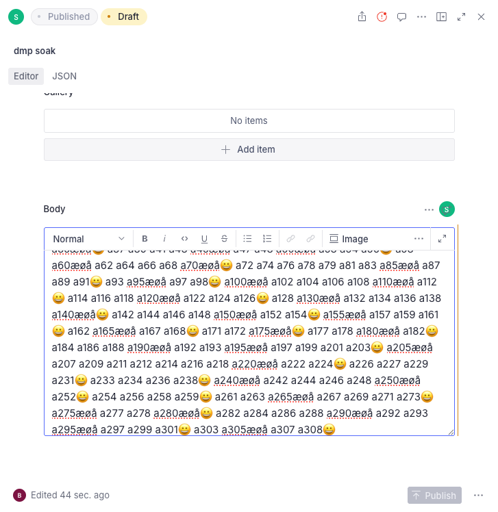

# Two editors, one paragraph

*Two people can now type in the same paragraph at the same time, and both keep every word. In a test on the old code, a third of the words vanished.*

After ten minutes of two browsers typing into one paragraph: numbered words, Norwegian letters and emoji, each one there once. A local test run.

## What changed for the person typing

Studio's rich text field, Portable Text, is where articles and posts are written.

Until now, two people in the same paragraph got in each other's way. Each save sent the whole paragraph. If the other person had saved first, the server said no, and the browser had to read again, merge and try again. Under real typing, words got lost on the way.

Now each save sends only the change: "add these letters here". Barkpark fits that change into the text it holds, even if the other person just changed it too.

| | What one key does |
|---|---|
| Before | Sends the whole paragraph. The other editor saved first, so the server refuses. Read, merge, send again. |
| Now | Sends a small patch (`diffMatchPatch`). The server merges it into the text it holds. The answer has both people's words. |

## The numbers

Two real browsers in one paragraph: a 12-second burst flat out, then a word every three or four seconds each, with æ, ø, å, emoji and Backspaces.

| Run | Saves | Refused | Words lost |
|---|---|---|---|
| Old code, 32 seconds | 58 | 4 | 20 of 60 |
| New code, 32 seconds | 65 | 0 | 0 of 57 |
| New code, 10 minutes | 664 | 2 | 0 of 309 |

In the ten-minute run, both pages ended up equal to the server, letter for letter, and neither page lost its typing focus.

## What almost went wrong

It took several rounds of review by reviewers who had not written the code. Each round tried to break it with real browsers and with fuzzing: thousands of small random edits.

**One round found doubled words.** When both people added a short word at the same spot at the same moment, one word came out twice, in 6 rounds out of 6. A fuzz run of 46,000 keystrokes, placed at every distance from the other person's cursor, doubled letters 1,089 times. The cause: the browser guessed whether its patch had landed by how alike the texts looked. The fix stopped guessing. The server's answer is the truth, and when that is not clear, the browser reads the document's history to find out. On the fixed code: 0 doubled, 0 lost, at every distance.

**A later round found one lost letter.** If the history read failed, say on a bad network, a letter typed into a word the other person had just replaced could vanish. Now a failed read is asked again every two seconds, and the save waits; the footer says "Saving is taking longer than usual…" meanwhile. The letter is kept. The next round passed.

## How Barkpark helped

Barkpark counts positions in bytes, and æ, ø, å and emoji take more than one byte. When the other person had typed one of those before your place, a patch could point into the middle of a letter, and Barkpark refused it: 7 of 328 patches in the ten-minute run. Studio fell back to sending the whole paragraph, so nothing was lost.

Barkpark fixed it the same day: a patch that lands inside a letter is now placed by the words around it instead of being refused.

## What is left

Two asks for Barkpark would make this exact instead of careful: say which parts of a patch were skipped (then no history read is needed), and let a late patch be refused (today a patch held up inside the server can still land after a newer save). On the final code the reviewer could not produce a lost, doubled or garbled word.

## Proof

- Studio: [#1251](https://github.com/FRIKKern/barkpark-studio/pull/1251), merged 15 November 2026 as `8eb2457f`. Final review passed on head `170c5a5b` with 9 of 9 checks green.
- Barkpark: [FRIKKern/barkpark#26499](https://github.com/FRIKKern/barkpark/pull/26499), merged 15 November 2026 as `e22d3281`.
- Code: `app/src/lib/pt-dmp.ts` (new), `app/src/lib/edits.ts`, `app/src/lib/merge.ts`. Tests: `app/src/lib/pt-dmp.test.ts`.
- The numbers come from the measurements in #1251's description. The picture is a still from that ten-minute local run, cropped. Built and reviewed; not yet signed off by the quality owner.
